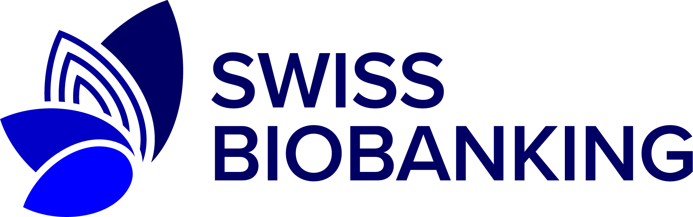

# Biobank Assessment Training Kit

for SBP NORMA and SBP OPTIMA Label evaluators

  
  
  

A **training programme** for new evaluators on how to assess biobanks for the **SBP NORMA Label** and the **SBP OPTIMA Label** of the Swiss Biobanking Platform (SBP).

Learn more about the labels at [swissbiobanking.ch/labels](https://swissbiobanking.ch/labels/).

## About the CS-BIQ project

**CS-BIQ — Czech-Swiss Biobank Infrastructure Initiative for FAIR Data and Quality Certification** connects the national nodes of BBMRI-ERIC in Czechia (**BBMRI.cz**) and Switzerland (**BBMRI.ch**, represented by the Swiss Biobanking Platform). It aims to strengthen the quality and interoperability of biobanking services in both countries, through biospecimen quality, FAIR data and a shared ethical and legal framework.

In the area of quality, the Swiss evaluation system (the SBP **VITA**, **NORMA** and **OPTIMA** labels) is introduced in Czech pilot biobanks to help them obtain the **BBMRI-ERIC Quality Label** or **ISO 20387 accreditation**. The Swiss partner provides methodological guidance and training, while the Czech node gradually takes over the evaluations during the project. **This training kit is part of that transfer.**

??? info "The two forms of quality recognition"
    **BBMRI-ERIC Quality Label:** awarded for specific processes or biospecimen types within a biobank, based on the Self-Assessment Survey (SAS) and a follow-up audit by BBMRI-ERIC. It confirms that the evaluated process meets European quality standards and is suitable for research use.

    **ISO 20387 accreditation:** formal recognition of the biobank as an organisation, granted by national accreditation bodies, confirming that it operates according to the international standard for biobanking and has a systematic quality management system across all its operations.

| Key facts | |
|---|---|
| **Funding** | Czech-Swiss Research Infrastructure Initiative, call 8K2502 |
| **Duration** | 36 months, March 2026 – February 2029 |
| **Swiss partner** | Swiss Biobanking Platform (SBP) |
| **Czech partner** | BBMRI.cz, represented by MMCI |
| **Contacts (SBP)** | Sabine Bavamian, Raphaël Colsenet, Flavien Delhaes |

## What this kit includes

-   **Learning objectives**

    ---

    What you will know, be able to do, and how you will work as an evaluator.

    [Learning objectives](objectives.md)

-   **Training curriculum**

    ---

    Five modules, from the labels themselves to professional conduct.

    [Start with Module 1](modules/module-1.md)

-   **Starter kit**

    ---

    Videos, checklists, documents and templates.

    [Starter kit](starter-kit.md)

-   **Step-by-step guideline**

    ---

    The workflow you will follow for every compliance review.

    [Guideline](guideline.md)

## How to use this kit

Start with the **Learning objectives**, using the **Next** button at the bottom right of this page or the menu on the left. Then follow the modules in order:

1. Understanding the SBP Labels (SBP NORMA Label and SBP OPTIMA Label)
2. SQAN training
3. Compliance review techniques & tools
4. Practical case studies
5. Professional conduct & compliance review rules

Keep the **Starter kit** and the **Step-by-step guideline** at hand: you will use them during the training and in your first compliance reviews.

!!! info "Access to documents"
    Some documents in this kit are stored on the SBP SharePoint. You may need to sign in with your SBP account to open them.

---

!!! quote "Disclaimer"
    The **CS-BIQ** project (*Czech-Swiss Biobank Infrastructure Initiative for FAIR Data and Quality Certification*), registration no. **8K0204**, is supported by Switzerland through the **Swiss-Czech Cooperation Programme**. Project duration: March 2026 – February 2029.

    This training kit reflects only the authors' views. The funders are not responsible for any use that may be made of the information it contains.
