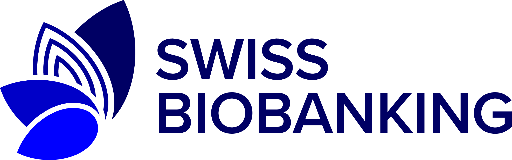

# Train-the-Trainer Kit for Biobank Assessment

  
  

A **training programme** for new evaluators on how to assess biobanks for the **SBP NORMA Label** and the **SBP OPTIMA Label** of the Swiss Biobanking Platform (SBP).

Learn more about the labels at [swissbiobanking.ch/labels](https://swissbiobanking.ch/labels/).

## What this kit includes

-   **Learning objectives**

    ---

    What you will know, be able to do, and how you will work as an evaluator.

    [Learning objectives](objectives.md)

-   **Training curriculum**

    ---

    Five modules, from the labels themselves to professional conduct.

    [Start with Module 1](modules/module-1.md)

-   **Starter kit**

    ---

    Videos, checklists, documents and templates.

    [Starter kit](starter-kit.md)

-   **Step-by-step guideline**

    ---

    The workflow you will follow for every compliance review.

    [Guideline](guideline.md)

## How to use this kit

Start with the **Learning objectives**, using the **Next** button at the bottom right of this page or the menu on the left. Then follow the modules in order:

1. Understanding the SBP Labels (SBP NORMA Label and SBP OPTIMA Label)
2. SQAN training
3. Compliance review techniques & tools
4. Practical case studies
5. Professional conduct & compliance review rules

Keep the **Starter kit** and the **Step-by-step guideline** at hand: you will use them during the training and in your first compliance reviews.

!!! info "Access to documents"
    Some documents in this kit are stored on the SBP SharePoint. You may need to sign in with your SBP account to open them.
