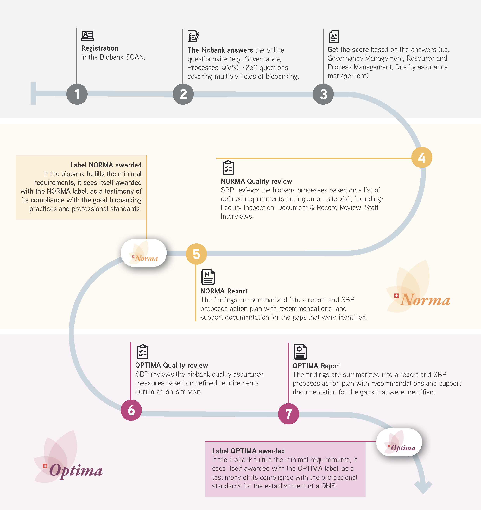

# Module 1 — Understanding the SBP Labels

*SBP NORMA Label and SBP OPTIMA Label*

## Topics

- Introduction to the SBP label strategy
- Purpose and scope of each label
- Differences between the SBP NORMA Label and the SBP OPTIMA Label
- Eligibility criteria, requirements and documentation
- The label cycle: application → compliance review → feedback and improvements → decision → label award

## The three labels at a glance

The Swiss Biobanking Platform (SBP) offers three labels, reflecting increasing levels of operational maturity. This kit focuses on **NORMA** and **OPTIMA**.

| | VITA | NORMA | OPTIMA |
|---|---|---|---|
| **Level** | Entry | Intermediate | Highest |
| **Main focus** | Governance and legal/ethical compliance | Standardised operational processes | Quality management system (QMS) and continuous improvement |
| **Assessment** | Remote: document review and online meeting | Document review and on-site visit | Document review and on-site visit |
| **Criteria based on** | Swiss law (Human Research Act and Ordinance), Declaration of Taipei, SBP recommendations | International standards and guidelines (OECD, IARC, ISBER, ISO — mainly ISO 20387), SBP recommendations | International standards and guidelines (OECD, IARC, ISBER, ISO — mainly ISO 20387), SBP recommendations |

## SBP NORMA Label

**Purpose:** the NORMA Label evaluates the quality of a biobank's operational processes and increases the harmonisation of practices between biobanks. Unlike the VITA Label, SBP examines the biobank's practices and processes **during an on-site visit**.

**What the compliance review covers:**

Resources and infrastructure
:   Facilities, equipment and the infrastructure supporting biobank operations.

Personnel and competencies
:   Staff, responsibilities, training and competencies.

Process management
:   The whole sample life cycle, from collection through processing, storage and transport to distribution.

Methods and quality control
:   Validation of methods and the quality control strategy.

**Support documents** for biobanks (SOP templates and datasets): Biological Material Management, Equipment Management, Personnel Management, Quality Control Strategy Implementation, Validation of Methods, and datasets for human, veterinary and bacterial collections.

## SBP OPTIMA Label

**Purpose:** the OPTIMA Label is the highest level. It focuses on optimising the biobank's quality management system and supports long-term sustainability and continuous improvement. It is also assessed **during an on-site visit**.

**What the compliance review covers:**

Quality governance
:   How quality is organised and steered in the biobank.

Documentation and information management
:   Control of documents and records, and management of information.

Continuous improvement
:   Management reviews, internal audits and handling of non-conformities.

Risk and sustainability
:   Risk management, biosafety, business model and cost recovery.

**Support documents** for biobanks (SOP templates): Quality Manual, Documentation Management, Internal Audit, Non-conformity Management, Improvement Management, Risk Management, and a Service Level Agreement template.

!!! tip "NORMA and OPTIMA in one sentence"
    **NORMA** checks that the biobank's processes are standardised and controlled. **OPTIMA** checks that the biobank has a quality management system that keeps those processes improving over time.

## Who can apply

All human and non-human biobanks that collect, store or manage biological samples for research, whether institutional, hospital-based or independent, public or private. Biobanks can apply at any stage of development, from new entities to mature infrastructures, and there is no restriction on size or sample type.

## The label process

1. **Registration and self-assessment.** The biobank registers on the online platform (SQAN) and answers the questionnaire on governance, processes and the QMS.
2. **Expert review.** SBP reviews the documents, then holds an online meeting (VITA) or an on-site visit (NORMA, OPTIMA).
3. **Feedback.** SBP sends a report with observations and recommendations, plus support materials such as SOP templates.
4. **Award and annual follow-up.** Biobanks that meet the requirements receive the label. A yearly review checks continued compliance and keeps the information up to date.
5. **Visibility.** Labelled biobanks can be listed in the Swiss catalogue (SBP NExT) and the BBMRI-ERIC Directory. They receive a certificate and a communication kit.

**Typical timing:** about two weeks for the document review, then about two weeks after the compliance review to write the report and award the label. The biobank's own preparation time also affects the timeline.

## SBP Labels and ISO 20387

The SBP Labels are **not** an ISO accreditation, which can only be granted by an external accreditation body. They support biobanks on their way towards ISO 20387 accreditation or the BBMRI-ERIC Quality Label.

## Material

- [SBP Labels — swissbiobanking.ch](https://swissbiobanking.ch/labels/){ target="_blank" }
- [SBP document library (support documents for each label)](https://swissbiobanking.ch/documents/){ target="_blank" }
- [Overview of the label process — SBP NORMA & SBP OPTIMA (PDF)](https://swissbiobanking-my.sharepoint.com/:b:/g/personal/valeria_dicola_swissbiobanking_ch/IQAfOQzynlS_TYGCYHH9qYx-AWR6fVSx8zO7NRT0rc9HYRg?e=xEvXGN){ target="_blank" }

<figure markdown>
[{ .process-figure }](../assets/images/label-process-overview.png){ target="_blank" }
<figcaption>The SBP label process, step by step. Click the image to open it full size.</figcaption>
</figure>
